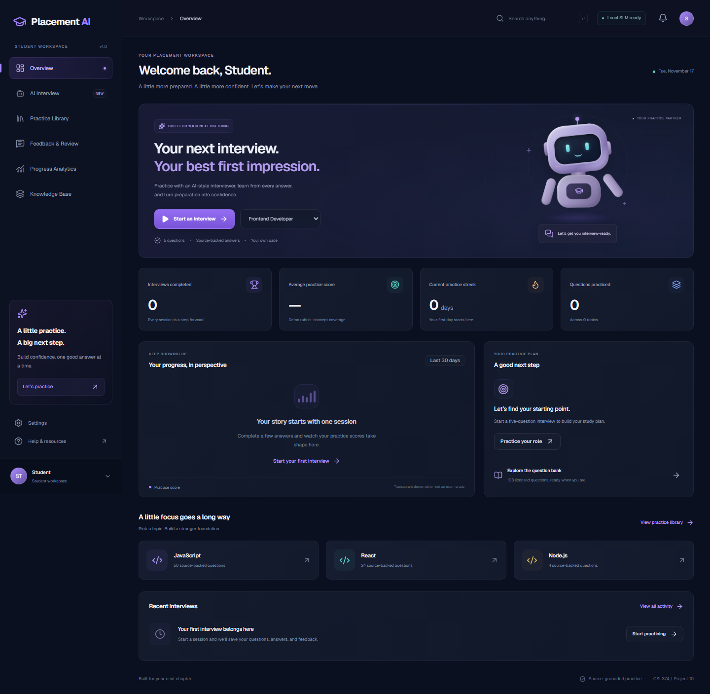

# Placement AI

A source-grounded interview practice workspace for **CSL374 Project 10 — Placement Interview Prep Bot**. Six responsive screens cover the overview, animated interview room, practice library, answer review, progress analytics, and knowledge/agent workspace.

The application works without a paid model account. It retrieves licensed public Q&A, selects exactly **five distinct questions**, preserves reference answers and citations, and explains a transparent concept-coverage rubric. The optional local **Llama-3.2-3B-Instruct** service provides genuine source-grounded answer generation and optional interview follow-ups. Real model output and rule-based scores are labelled separately. **Built with Llama.** No paid API or Ollama is used.



## Run with Docker

Install and start Docker Desktop with Linux containers. From this directory:

```powershell
powershell -NoProfile -ExecutionPolicy Bypass -File scripts/init-env.ps1 -AdminEmail admin@placement.local
powershell -NoProfile -ExecutionPolicy Bypass -File scripts/prepare-slm.ps1
powershell -NoProfile -ExecutionPolicy Bypass -File scripts/prepare-voice.ps1
docker compose -f compose.yaml -f compose.slm.yaml up --build -d
```

Open **http://127.0.0.1:8088** and choose **Explore demo workspace**, or create an account. Demo workspaces are isolated and start with empty progress. Administrator credentials are generated into the ignored `.env`; inspect that file locally to sign in as the administrator and manage sources. Never commit it. The initializer preserves an existing `.env` rather than rotating its secrets.

The model preparation downloads approximately 2.02 GB of public Q4_K_M weights and verifies their pinned SHA-256. Weights stay in ignored `.models/`; the license and attribution are in `data/model-licenses/`. In Knowledge Base → Agent workspace, **Run local model test** returns an actual response. RAG inspector lets you explicitly choose **Use local SLM for this answer**. Source-only practice remains available if the model is stopped.

Voice preparation verifies a roughly 63 MB Piper ONNX voice and configuration. Browser speech synthesis is used when an installed voice is available; otherwise the application plays locally generated Piper WAV audio. Piper is an open-source speech engine, not the reasoning model. Browser speech recognition handles microphone transcription; local Llama provides the contextual explanations.

For the lightweight demo without model downloads, use `docker compose up --build -d` with only the base file. The base configuration deliberately defaults to source-only demo mode. The full local model runs on the private container network and publishes no model port.

```powershell
docker compose -f compose.yaml -f compose.slm.yaml ps
docker compose -f compose.yaml -f compose.slm.yaml logs --tail 50 api agent
docker compose -f compose.yaml -f compose.slm.yaml stop
docker compose -f compose.yaml -f compose.slm.yaml up -d
```

PostgreSQL and imported sources persist in named Docker volumes. `stop` preserves them. Only loopback port 8088 is published; the database and agent remain on the private Compose network. Initial image/dependency downloads require Internet access.

## Run locally on Windows

Prerequisites: Node.js 22.12+ (22.18 was tested), a JDK 17+ (Java 23 was tested), and [uv](https://docs.astral.sh/uv/getting-started/installation/). Maven 3.9.11 is downloaded into ignored `.tools` by the helper and checked against its SHA-512 checksum. Python 3.12 is provisioned by uv, avoiding Windows Python execution aliases.

```powershell
powershell -NoProfile -ExecutionPolicy Bypass -File scripts/setup.ps1
powershell -NoProfile -ExecutionPolicy Bypass -File scripts/init-env.ps1 -AdminEmail admin@placement.local
powershell -NoProfile -ExecutionPolicy Bypass -File scripts/start-local.ps1
```

Open **http://127.0.0.1:5173**. The API is at `http://127.0.0.1:8080/api`; agent OpenAPI documentation is at `http://127.0.0.1:8001/docs`. Private agent requests require the internal token. The local profile uses **file-backed H2**, explicitly separate from the PostgreSQL Compose profile.

```powershell
powershell -NoProfile -ExecutionPolicy Bypass -File scripts/stop-local.ps1
```

Logs and owned process IDs are in `.runtime`. The stop script checks process identity before stopping it. Stop local services before rebuilding the Java JAR on Windows; a running JAR can be locked. To work on individual services, use `npm run dev` in `frontend`, `uv run uvicorn app.main:app --host 127.0.0.1 --port 8001` in `agent`, and `java -jar target/placement-api-1.0.0.jar` in `backend`, with matching environment variables loaded in their shells.

## What works

- Register/sign in, BCrypt password hashing, expiring JWTs, isolated guest accounts, environment-only admin bootstrap, user-scoped records.
- Exactly-five interview setup, role/topic/difficulty filters, typed answers, optional microphone transcription, question replay with browser TTS, pause/end/resume navigation, saved feedback and follow-ups.
- Search, source answer reveal, bookmarks, completed filters, and personal five-question practice sets.
- Actual session/answer analytics, topic coverage, date ranges, CSV export, and session deletion. Empty accounts have no fabricated scores or trends.
- Licensed-source catalog, admin JSON/CSV/PDF/DOCX import/reindex/delete, RAG query inspection, citations and real LangGraph selection traces.
- Genuine local Llama-3.2-3B-Instruct inference, explicit source-grounded generation, model health/test controls, disabled/unreachable-model fallback, and authenticated private inference.
- No paid provider calls, disabled hosted tracing, clear no-source fallback, upload validation and internal service authentication.
- Contextual **Ask Ava** tutoring: clarification/help requests are not graded or counted as answers. Ask for explanations/examples, ask follow-up questions, or use **Explain this feedback**. Conversation persists within the owned interview and does not advance its five scored questions.
- Interview replies appear in **text and audio by default**, with a **Spoken replies** mute control. **Start voice interview** requests microphone consent, reads the question, listens for a candidate answer, and then displays and speaks the same feedback/follow-up. Follow-up responses use contextual chat without adding scored turns. Say **next question** or use its button to continue. **Ask with voice** remains available for ungraded clarification. Pause/end/navigation cancel speech and capture; typed chat always remains available.
- **Knowledge Base → My study documents** accepts ordinary PDF/DOCX/TXT/Markdown prose for any signed-in user. Request explanatory notes or 1–5 practice questions, inspect document passage citations, revisit saved materials, download Markdown, or delete your private document.

Browser speech recognition varies by browser and can use a vendor's service. It requires explicit consent and a visible microphone state; typed input remains available. Placement AI stores answer text, not microphone audio. The interviewer is a CSS-animated robot, not live avatar video. Physical microphone/TTS behavior still needs a manual check on the presentation device.

To learn rather than submit an answer, type “I don’t understand this; can you explain it?” and choose **Ask Ava instead**, or use the dedicated Ask Ava box. Explanations stay visible and are spoken unless muted. The tutoring endpoint carries the current reference, recent conversation, and any saved candidate answer/asked follow-up, so “give me an example of that” retains context. Original reference answers remain visible; generated explanations may still need checking against them. Long replies are spoken in sequential chunks; the microphone resumes only after the final chunk.

Personal study documents are separate from the administrator-managed public Q&A bank. They need no existing Q:/A: formatting or public provenance URL. Text extraction supports readable documents; scanned PDFs require OCR beforehand. Private chunks/materials are stored in the owner's database record, never added to the shared source catalog. If inference fails, source-extracted fallback notes/prompts are clearly labelled.

Interview scores remain transparent lexical proxies even when the local model is available. Optional generated interview follow-ups can be enabled with `LOCAL_SLM_FOLLOWUPS=true` in `.env`, followed by recreating the agent with both Compose files. They have a 12-second budget and fall back to the source template. Default follow-ups remain deterministic for fast, reproducible practice. Stored evaluation metadata identifies the actual follow-up origin.

## Data and retrieval

The initial bank contains **103 Q&A records and 137 overlapping chunks** from an MIT-licensed public GitHub repository. The original license, immutable revision and per-question source locators are included in [data/ATTRIBUTION.md](data/ATTRIBUTION.md). Source examples include older APIs; inspect citations when studying them.

Supported initial roles: **Frontend Developer, React Developer, JavaScript Developer, Full Stack Developer, and Backend Developer** (Node.js/JavaScript). Topics include JavaScript, React, Node.js, HTML, CSS, Accessibility and Security. Java/Python/SQL banks can be added by an administrator using appropriately licensed sources; their coverage is not fabricated in the seeded catalog. Topic/difficulty combinations with fewer than five questions return a clear setup error.

```powershell
powershell -NoProfile -ExecutionPolicy Bypass -File scripts/ingestion-sample.ps1
```

Default retrieval is local lexical ranking. Optional **sentence-transformers + FAISS** mode indexes actual chunks with the Apache-2.0 [all-MiniLM-L6-v2 embedding model](https://huggingface.co/sentence-transformers/all-MiniLM-L6-v2). Embeddings are not chat/SLM inference. Prepare it locally:

```powershell
cd agent
uv sync --extra semantic --frozen
uv run --extra semantic python -m app.prepare_embeddings
uv run --extra semantic python -m app.check_embeddings
```

Set `RETRIEVAL_BACKEND=semantic` in `.env` and restart local services. Serving uses local weights only. Base `uv sync` removes optional dependencies; retain `--extra semantic` when using this mode. Docker semantic mode additionally needs `INSTALL_SEMANTIC=true`, an agent rebuild, and one explicit `docker compose run --rm agent /app/agent/.venv/bin/python -m app.prepare_embeddings` to populate its source volume before enabling semantic retrieval. The default Docker image remains lightweight and lexical.

## Verify

```powershell
# Python (from agent/)
uv run --extra voice --extra semantic pytest -q

# Java (from backend/; stop any local API before packaging)
.\mvnw.cmd -B package

# Frontend (from frontend/)
npm run build
npx playwright install chromium
npm run test:e2e

# Real services (from repository root with local services running)
node scripts/smoke.mjs
```

Browser tests require a running app. To use Compose, set `PLAYWRIGHT_BASE_URL=http://127.0.0.1:8088`. Tests cover real API interactions, five-answer completion, bookmarks/custom sets, retrieval/fallback, simulated microphone denial, and mobile layout/navigation.

Import [the Postman collection](docs/Placement-AI.postman_collection.json) and run it in order. Its default `base_url` is `http://127.0.0.1:8088`; use port 5173 locally. Auth/session variables are captured automatically. The collection has also been executed through Newman; [the summary](docs/evidence/postman-summary.json) records requests and assertions without authentication tokens.

See [EVIDENCE.md](docs/EVIDENCE.md) for executed checks and academic DoD status, [actual API responses](docs/evidence/actual-api-results.json) for three role queries and a failure case, and [DEMO.md](docs/DEMO.md) for a five-minute presentation script.

Genuine inference and unavailable-model evidence are in [local-slm.json](docs/evidence/local-slm.json). Reproduce them with `node scripts/model-evidence.mjs` against the model-enabled Docker deployment. [model-deployment-check.json](docs/evidence/model-deployment-check.json) verifies a persisted generated follow-up and unchanged deterministic scores.

The completed **[five-minute narrated demo](docs/demo-output/Placement-AI-five-minute-demo.mp4)** records the earlier baseline application and a genuine local-model response. It predates the contextual tutoring/private-study-document extension. It is exactly 300 seconds of H.264/AAC video with offline narration. [Transcript](docs/demo-output/transcript.md), [recording evidence](docs/demo-output/recording-manifest.json) and [reproduction instructions](docs/demo-recording.md) accompany it. Current verification results are centralized in [EVIDENCE.md](docs/EVIDENCE.md).

## Architecture and repository

React → Spring Boot gateway → FastAPI/LangGraph service → licensed Q&A / optional local embeddings + FAISS. PostgreSQL persists users, interview snapshots/turns, bookmarks and practice sets. Admin source metadata/Q&A persist on the agent volume. See [ARCHITECTURE.md](docs/ARCHITECTURE.md) and [API_CONTRACT.md](docs/API_CONTRACT.md) for boundaries and the source-metadata simplification.

| Directory | Responsibility |
| --- | --- |
| `frontend/` | React 19, TypeScript, Vite, Tailwind 4, Lucide, Recharts, browser tests |
| `backend/` | Spring Boot 3.5, Spring Security, JWT, JPA, PostgreSQL/H2, integration tests |
| `agent/` | FastAPI, Pydantic, LangChain Core, LangGraph, import/retrieval/evaluation, Python tests |
| `data/` | Vendored public bank, original license, provenance |
| `scripts/` | Setup, service lifecycle, REST smoke checks and evidence capture |
| `docs/` | Plan, API contract, decisions, architecture, demo, Postman and evidence |

## Academic and deployment limits

**DoD 2 is now demonstrated with the handout's suggested model:** quantized Llama-3.2-3B-Instruct runs locally through llama.cpp. The authenticated application model test returned a correct closure explanation, and actual output, usage, model identity and latency are saved in the evidence. The optional Grok proposal is unnecessary for this implementation and remains disabled. A base demo deployment alone does not claim inference; use the model-enabled deployment for that demonstration.

Internet deployment still needs HTTPS, abuse controls, backups, reviewed migrations and JWT revocation requirements. The Java/Python/PostgreSQL stack requires a container-capable host; static Sites hosting alone cannot run it.

Read [AGENTS.md](AGENTS.md), [the implementation plan](docs/IMPLEMENTATION_PLAN.md) and [decisions](docs/DECISIONS.md) before changes. Preserve **READ → REMEMBER → PLAN → CODE → VERIFY**.
