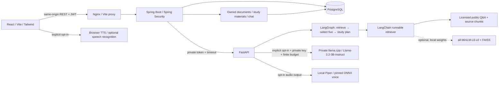

# Architecture and behavior

## Service responsibilities

The browser calls only `/api`. Vite proxies to localhost:8080 during development; Nginx proxies to `api:8080` in Compose. The gateway owns identity, user isolation, interviews, answers, bookmarks, practice sets and analytics. PostgreSQL stores these records in the full-stack configuration; the local profile explicitly uses file-backed H2.

The private agent requires `X-Internal-Token` on every `/internal/*` endpoint. Only its minimal `/health` endpoint is public. Compose does not publish database, gateway, agent or local-SLM ports to the host. Nginx is bound to loopback port 8088. The optional model override adds an authenticated private llama.cpp CPU server, pinned image digest, read-only verified GGUF mount, and local-only agent adapter.

Interview sessions retain JSON snapshots of questions, references, follow-ups, turns, evaluations and selection traces. SourceDocument metadata and imported Q&A are persisted as validated atomic JSON files on the agent volume, rather than duplicated in PostgreSQL. This is a documented simplification of the proposed source-metadata architecture. Removing a source affects future retrieval; historical interview references remain available. Active interviews using a deleted source may need to be ended and restarted because evaluation requires that source to remain in the bank.

## Retrieval and agent bounds

The default bank indexes 132 theory records across ten topics. Ingestion cleans and validates records, retains source locators and licenses, and splits text into overlapping chunks of 1,200 characters with a 1,000-character stride. Bundled role mappings use the primary topic. The catalog advertises role, topic, and difficulty choices backed by at least five questions. Retired exercises stay outside active retrieval and selection, and saved interview snapshots retain their original references.

Default retrieval uses local lexical TF-IDF-style ranking with a relevance coverage gate. Optional semantic mode embeds the actual chunks with `all-MiniLM-L6-v2`, normalizes vectors, and searches a FAISS inner-product index. Source-compatible lexical evidence still gates semantic results to preserve an honest missing-source fallback. Semantic mode requires installed optional dependencies and previously downloaded weights; it does not silently download a model while serving requests.

Interview setup runs a real three-stage LangGraph with recursion limit 8: retrieve candidates, select exactly five questions using a topic round-robin or validated custom set, and create a template study plan. LangChain Core supplies typed Documents and the query retriever runnable. A trace records stage, decision, duration and source-supported behavior. There are no autonomous web tools, paid provider adapters, unbounded retries or document-controlled tool calls. Read retries are user initiated; writes reject duplicate answers and lock the session during mutation. The gateway waits at most 45 seconds; normal browser requests allow 30 seconds and explicit model requests allow 65 seconds. Nginx allows 60 seconds.

The optional SLM adapter permits only loopback or known private Docker hostnames at `/v1`, rejects hosted URLs and redirects, and allows one inference at a time. Basic tests and explicitly requested grounded answers have a 25-second/96–128-token budget. Optional answer-conditioned follow-ups have a 12-second/64-token budget. Model failure preserves the original reference answer or deterministic follow-up with an explicit warning. Missing source evidence never invokes the model. Citations and the exact-five source answers are preserved by the application rather than invented by the model.

## Transparent feedback

Help requests and detours use a separate interview conversation. The gateway sends the saved question/reference and latest six same-question messages to the local model. The latest request determines whether Ava uses the reference or follows a general topic from the discussion. The gateway attaches the saved citation only to interview-grounded replies. Conversation messages are owner-scoped and persisted with the session without advancing the five scored questions.

For follow-up dialogue, the gateway adds the stored candidate answer and actual asked follow-up to private model context. The UI keeps the interviewer reply visible and speaks the same text, then captures one completed candidate turn after consent. Main answers use the existing scored-answer endpoint; clarification and follow-up discussion use chat. Next-question navigation is explicit through a button or voice command. Speech defaults on with mute, while microphone capture requires consent. Sequential audio chunks preserve long replies, and stop/pause/navigation invalidate stale capture/playback callbacks.

Personal study documents are stored separately as owner-scoped database rows containing extracted chunks and generated material history. Ordinary PDF/DOCX/TXT/MD prose is supported. The agent extracts text without retaining private files, selects bounded relevant passages for the requested notes or questions, verifies question count/citation IDs, and labels source-extracted fallback. These files never enter the shared question index.

Browser speech recognition provides opt-in transcription. Installed browser voices provide narration where available; otherwise an authenticated gateway route returns WAV audio from the local Piper 1.8.0 CPU engine and pinned CC0 voice. Audio is not persisted. Capture, requests and playback are cancelled on stop/pause/navigation, and typed chat remains usable.

For each source rubric concept, the evaluator tests whether at least 45% of its nontrivial words appear in the answer. Accuracy and completeness are explicitly labelled lexical proxies. Clarity is an answer-length proxy, reaching 100 at 20 words if at least one concept matches. Overall score is 85% concept coverage and 15% the length proxy. Nonsense with no matching concepts scores zero. The rubric cannot detect negation, incorrect explanations, confident fabrication or paraphrases reliably; it must not be represented as a factual or human assessment.

Every selected question starts with exactly one deterministic follow-up based on a cited concept. A separately enabled local-model follow-up may replace that practice prompt after an answer; saved `follow_up_mode` and model metadata identify its origin. The score remains rule-based. The follow-up is not an additional scored interview turn. Study recommendations derive from actual topic coverage and saved scores.

## Identity, privacy and security

- BCrypt hashes passwords; signed HMAC JWTs expire after 12 hours and validate issuer/timestamps. Browser tokens remain in local storage. Sign-out removes the local token; this small application does not implement a server-side JWT revocation list.
- A demo login creates an isolated ordinary USER. Administrator creation is environment-only; no public role-elevation input exists. Disable `DEMO_ENABLED` for deployments where anonymous account creation is unwanted.
- Every session, bookmark and practice-set lookup is scoped to the JWT subject. Administrators alone can import, reindex or delete shared sources.
- Shared bank imports require an approved license and public HTTPS provenance. JSON and CSV require structured Q&A. Shared PDF/DOCX imports require explicit `Q:` and `A:` pairs. Personal study documents accept ordinary prose without inventing public licenses or URLs. Uploads are limited to 5 MB; DOCX expanded size/count and PDF page count are limited. Extracted content is data and never receives execution privileges.
- The app never renders source HTML. No microphone audio is sent to the gateway or stored. Optional browser speech recognition may use a browser vendor's service; consent explains this. The avatar is CSS animation, not live video or photorealistic video generation.
- LangSmith tracing is disabled in code and containers. Logs contain trace IDs, paths, status, decisions and timing rather than tokens, passwords, answers or microphone data. The Java main entrypoint neutralizes a host-wide `DEBUG` variable to prevent accidental request-body logs.
- Compose requires generated secrets and the PostgreSQL profile rejects known development tokens. Nginx adds CSP, frame protection, MIME sniffing protection and a microphone permissions policy. HTTPS termination, network-level abuse controls, backups and formal migrations are deployment hardening work for an Internet-facing service.

## Cost and academic scope

The base demo is always available without provider keys. The optional full deployment uses local Llama-3.2-3B-Instruct CPU inference, matching the handout's suggested SLM. It has been exercised through the authenticated application API, separately from the embedding model. Setting a Grok flag cannot trigger a paid call because no hosted provider client is wired in. Basic inference, source-grounded generation, unavailable-model fallback and persisted generated follow-ups are captured in `docs/evidence/`. These artifacts support the academic demonstration; instructor grading is not asserted.
